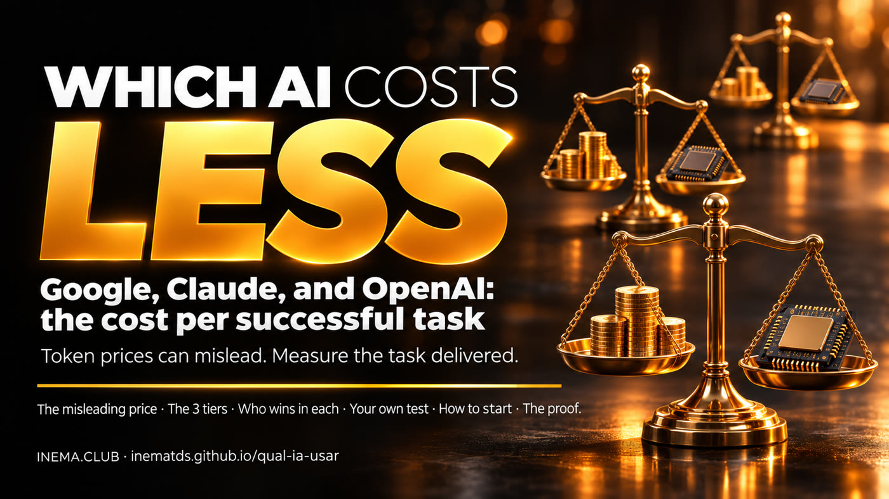

# ⚖️ Which AI to Use - GEMINI - GPT - CLAUDE

**🇧🇷 [Português](README.md) · 🇺🇸 [English](README.en.md) · 🇪🇸 [Español](README.es.md)**

[](https://inematds.github.io/qual-ia-usar/guia/en/)

## What it is

This project compares ten AI models from three companies: Google's Gemini 4 (Neon, Argon, and Hydrogen), Anthropic's Claude (Fable, Opus, Sonnet, and Haiku), and the OpenAI models used by Codex (Astra, Sol, and Luna). It brings together official pricing tables and the Agent Arena leaderboard, a public ranking that measures AI agents performing real-world tasks, checked on Nov 19, 2026. It's for people who pay for AI and want to choose without wasting money. You don't need anything to read it. To test with your own task, all you need are the apps you already use (ChatGPT, Claude, or Gemini), or the testing kit, which runs the same task across every AI you enable and shows which one got more right for less.

## 📖 Guide

Complete guide, in plain language: **https://inematds.github.io/qual-ia-usar/guia/en/**

## The idea in one line

The cheapest AI in the pricing table can end up costing more on your bill. What matters is the **cost per successful task**: everything you paid, including failed attempts, divided by the tasks that were completed correctly.

## Who wins in each tier (Nov 19, 2026)

Price in US$ per million tokens (input / output). Score and cost per task: Agent Arena.

| Tier | Google | Anthropic | OpenAI |
|---|---|---|---|
| Complex work | Gemini 4 Neon · 3 / 15 · Score 1333 · US$ 2.60 per task | Claude Opus 5.5 · 4 / 20 · 1336 · US$ 5.98 | GPT-6.2 Astra · 8 / 40 · 1291 · US$ 3.11 |
| Everyday work | Gemini 4 Argon · 2 / 10 (4 / 20 starting Dec 1) · 1229 · US$ 0.66 | Claude Sonnet 5.5 · 2 / 10 · 1296 · US$ 3.27 | GPT-6.2 Sol · 2 / 10 · 1241 · US$ 0.96 |
| High volume | Gemini 4 Hydrogen · 1.50 / 7.50 · 1271 (preliminary) · US$ 1.50 | Claude Haiku 5.5 · 0.10 / 0.50 · no score | GPT-6 Luna · 0.10 / 0.50 · no score |

Outside the tiers: **Claude Fable 5.2** (US$ 8 / 40) leads the leaderboard with a score of 1448 and costs US$ 9.16 per task.

- **Complex work:** Neon nearly ties with Opus and costs less than half as much per task.
- **Everyday work:** all three charge the same per token; per task, Argon costs less and Sonnet has the best score.
- **High volume:** Haiku and Luna charge 15 times less per token than Hydrogen; their quality can only be determined by testing.
- **Within Google:** Hydrogen is cheaper per token than Argon, but cost more than twice as much per task.

What this comparison does not promise: the tier figures are published numbers (the custom test below covers one task and seven models), the leaderboard measures agents performing general tasks, not yours, and everything changes over time.

## How to get started (without programming)

Open Claude Code or Codex in one of your folders and paste:

```text
Read the "Which AI to use" project at https://github.com/inematds/qual-ia-usar (the README explains the testing kit in kit/testar.py).
I want to know which AI has the lowest cost per successful task for one of my tasks: [describe the task and what "done right" means].
1. In plain English, tell me which 3 or 4 models are worth testing for this task and why.
2. Propose a small test: how many times to run each model and how much it should cost.
3. Don't call any model or spend anything before I say yes.
After I say yes, set up the task in the kit format (kit/testar.py), run the test, and show me the report.
```

## Testing kit: your task across all AIs

You describe the task and what "done right" means. The kit runs the same task on each AI several times, evaluates each response (an AI judge and, if you want, an automated checker), and returns a report: how many were correct, the time, and the cost per successful task.

**Real test (Nov 19, 2026, receipt task, 2 runs each; Claude and GPT via subscription, Gemini via API):**

| Model | Correct | US$ per successful task | Median time |
|---|---:|---:|---:|
| GPT-6 Luna | 2/2 | 0.00008 | 7 s |
| Claude Haiku 5.5 | 2/2 | 0.00038 | 6 s |
| GPT-6.2 Sol | 2/2 | 0.00155 | 9 s |
| Claude Sonnet 5.5 | 2/2 | 0.00316 | 4 s |
| GPT-6.2 Astra | 2/2 | 0.00656 | 11 s |
| Claude Opus 5.5 | 2/2 | 0.00813 | 6 s |
| Gemini 4 Hydrogen | 2/2 | 0.00869 | 6 s |
| Claude Fable 5.2 | 2/2 | 0.01552 | 5 s |
| Gemini 4 Neon | did not run | — | — |
| Gemini 4 Argon | did not run | — | — |

For a simple task, all models get it right, so the cheapest wins: Fable cost about 200 times as much as Luna for the same successful task. Hydrogen, Google's cheapest model per token, cost more than Opus per successful task because it wrote two to four times more text. Neon and Argon did not run: the test API key did not have quota for them (error 429). A Fable response was initially rejected because of a checker error; it was fixed and re-evaluated with `--reavaliar`. Full report: [results/2026-11-19-2317-comprovantes](resultados/2026-11-19-2317-comprovantes/relatorio.md) (in Portuguese).

## In practice: "How Nei chooses"

- **Luna and Haiku:** they cost cents and got the simple task right. Good options for simple, long-running tasks (many repeated steps, high volume).
- **Terra and Sonnet:** in Nei's tests, the favorites are GPT-6.1 Terra and Claude Sonnet 5.5. They cost more but deliver good results more consistently. Within OpenAI, from lowest to highest: Luna, Terra, Sol, and Astra. Terra is not in this project's tables.
- **Neon as a critic:** Nei currently uses Claude and Codex to review each other, because models from different companies make different mistakes. Gemini 4 Neon could be the AI that validates and critiques for someone who only has Claude or only has Codex.

## Technical installation

Only Python 3 is required (no extra libraries).

```bash
git clone https://github.com/inematds/qual-ia-usar
cd qual-ia-usar
python3 calcular.py --precos                              # token pricing table
python3 calcular.py --arena                               # Agent Arena leaderboard + points per dollar
python3 calcular.py exemplos/tentativas-exemplo.csv       # fictional test example
```

### Testing kit

```bash
python3 kit/testar.py kit/exemplo-comprovantes --simular              # shows the plan, doesn't call anything
python3 kit/testar.py kit/exemplo-comprovantes --so "Claude,GPT" --repeticoes 2
python3 kit/testar.py minha-tarefa/ --juiz claude-cli:claude-sonnet-5-5
python3 kit/testar.py kit/exemplo-comprovantes --reavaliar resultados/<pasta>   # reruns the checker and judge on saved responses
python3 kit/teste_vias_api.py                                         # tests the API routes against a mock server
```

**The task** is a folder with `tarefa.json`:

```json
{"nome": "comprovantes",
 "pedido_arquivo": "pedido.md",
 "criterio": "como é 'ficou certo', ponto por ponto",
 "verificar": "python3 verificar.py",
 "repeticoes": 3}
```

`verificar` is optional: a command that receives the response path and exits with 0 when it is correct. A response counts as correct only if it passes **both** the checker and the judge.

**The models** are listed in `kit/motores.json` (`modelo` must match a name in `dados/precos-*.csv`, plus `via` and `id`). Routes:

| Route | How it runs | Requires |
|---|---|---|
| `claude-cli` | `claude -p`, no tools | Claude Code logged in (subscription) |
| `codex-cli` | `codex exec`, read-only sandbox | Codex logged in (subscription) |
| `gemini-cli` | `gemini -p` | Gemini CLI installed and logged in |
| `api-anthropic`, `api-openai`, `api-google`, `openrouter` | HTTP API | `ANTHROPIC_API_KEY`, `OPENAI_API_KEY`, `GEMINI_API_KEY`, `OPENROUTER_API_KEY` |

Cost is calculated from measured tokens × the official pricing table. Claude Code, Codex, and Gemini CLI add their own instructions to every prompt; the kit measures this overhead once per model and subtracts it (the raw number is in the `tokens_entrada_bruto` column). With a subscription, you don't pay per task: read the cost as "what it would cost per use." Calls that fail (quota, network, login) appear as "did not run" and do not count as model errors. The `api-google` route was tested for real (Hydrogen); `api-anthropic`, `api-openai`, `openrouter`, and `gemini-cli` were tested only against a mock server. Check each model's `id` in the company's documentation.

Output in `resultados/<data>-<nome>/`: the responses, `tentativas.csv` (which `calcular.py` also reads), and `relatorio.md`.

### Files

| File | What it is |
|---|---|
| `calcular.py` | Calculates the cost per successful task from a CSV of attempts |
| `dados/precos-2026-11-19.csv` | Official prices per million tokens, with the source for each row (in Portuguese) |
| `dados/arena-2026-11-19.csv` | Score and median cost per task on Agent Arena (snapshot from Nov 19, 2026) (in Portuguese) |
| `exemplos/tentativas-exemplo.csv` | **Fictional** test example (not a measurement) |
| `kit/testar.py` | Testing kit: runs the task on each AI, evaluates it, and calculates the cost per successful task |
| `kit/motores.json` | List of models and how to call each one |
| `kit/exemplo-comprovantes/` | Example task with an automated checker |
| `resultados/` | Reports from tests already run |
| `guia/` | The guide in PT, EN, and ES (GitHub Pages) |

### Attempt CSV format

One row per attempt:

| Column | What it contains |
|---|---|
| `modelo` | Must match a name in `dados/precos-2026-11-19.csv` (e.g., `Gemini 4 Argon`) |
| `execucao` | Label for each time you gave the task from scratch (1, 2, 3…). Fixes in the same run add to the cost and count as one task |
| `tokens_entrada`, `tokens_saida` | Tokens spent on the attempt |
| `custo_usd` | Amount charged, if shown in the dashboard. Empty = calculated from tokens and the pricing table |
| `aprovada` | `sim` or `não`. A run counts as a successful task if any attempt in it was approved |

Missing cost never becomes zero: the model appears as "no cost" and is excluded from the comparison.

### How the calculation works

`cost per successful task = total cost of all attempts ÷ number of approved runs`

To test with ready-made tasks and fictional data, use the Gemini 4 lab protocol: [protocol.md](https://github.com/inematds/gemini-4-na-pratica/blob/main/laboratorio/protocolo.md).

## Sources

- Google: [pricing](https://aistudio.google.com/docs/pricing) · [Neon](https://blog.google/innovation-and-ai/models-and-research/gemini-models/introducing-gemini-4-neon/) · [Argon](https://blog.google/innovation-and-ai/models-and-research/gemini-models/introducing-gemini-4-argon/) · [Hydrogen](https://blog.google/innovation-and-ai/models-and-research/gemini-models/introducing-gemini-4-hydrogen/)
- Anthropic: [pricing](https://platform.claude.com/docs/en/about-claude/pricing) · [Haiku 5.5](https://www.anthropic.com/claude-haiku-5-5)
- OpenAI: [pricing](https://developers.openai.com/api/docs/pricing) · [GPT-6.2](https://openai.com/index/introducing-gpt-6-2-astra-sol/) · [GPT-6 Luna](https://developers.openai.com/api/docs/models/gpt-6-luna)
- [Agent Arena](https://arena.ai/leaderboard/agent): Google at High effort, Anthropic and OpenAI at Max; cost = median per task over the last 14 days; score is not an accuracy percentage.

## The process, from start to finish

| # | Step | Command | Who |
|---|---|---|---|
| 1 | Check prices and leaderboard against official sources and update `dados/*.csv` | — | 🧠 session with Nei |
| 2 | Check the tables and calculations | `python3 calcular.py --precos` / `--arena` / `exemplos/tentativas-exemplo.csv` | ⚙️ script |
| 3 | Write the PT guide (`guia/index.html`) and generate cover and banners | `gerar-capa.cjs`, `gerar-banner.sh` | 🧠 + ⚙️ Codex image_gen |
| 4 | Translate the guide and README into EN/ES | `traduz-pagina-codex.py html` / `readme` | ⚙️ central translator |
| 5 | Independent review of the guide | `revisor-nota.py registra --fluxo guia` | 🤖 new reviewer |
| 6 | Publish: commit + push (GitHub Pages via Actions) | `git push` | 🧠 |
| 7 | Portal, search, and PRO catalog | skill `atualiza-portal` | 🧠 |
| 8 | Topic in INEMA.LLMS | skill `postar-telegram` | 🧠 |
| 9 | Comparison video on lives4 and embed in the guide (3 languages) | `yt-pub-x3` | ⚙️ x3 + 🧠 |

Free on inema.club, directly on the internet. MIT License.
